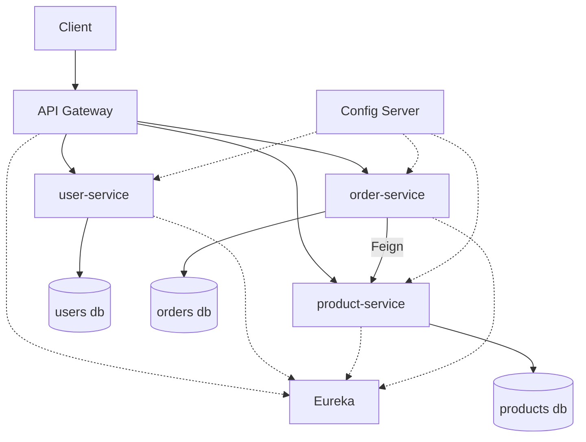

# Ecommerce Platform

**Purpose:** learn microservice architecture properly.
**Built in:** Week 6 (deliverable Mon 7 Dec), deployed in Week 7, polished in Week 8
**Stack:** Spring Boot, microservices, PostgreSQL
**Tracker:** [Tracker.md](Tracker.md)

## Services

| Service | Owns | Database |
|---|---|---|
| `product-service` | Products and categories | PostgreSQL |
| `order-service` | Orders and order items | PostgreSQL |
| `user-service` | Accounts, roles, JWT (reuse Week 5) | PostgreSQL |
| `inventory-service` (stretch) | Stock levels | PostgreSQL |
| `api-gateway` | Routing, auth check | none |
| `discovery-server` | Eureka | none |
| `config-server` | Central config | Git repo |

## Features

- [ ] Browse and search products
- [ ] Register and log in
- [ ] Place an order (calls product service for price and stock)
- [ ] Order history
- [ ] Circuit breaker on the order to product call
- [ ] Central config

## Architecture

## Milestones

| Date | Milestone |
|---|---|
| Tue 1 Dec | Boundaries drawn, discovery server and config server up |
| Wed 2 Dec | `product-service` and `user-service` registered |
| Thu 3 Dec | Gateway routing, JWT check at the gateway |
| Fri 4 Dec | `order-service` calling `product-service` with Feign |
| Mon 7 Dec | Circuit breaker, tests, README. Deliverable done. |
| Week 7 | Docker Compose and AWS deployment |

## Definition of done

- [ ] At least 3 services running behind a gateway
- [ ] Services find each other by name
- [ ] Killing `product-service` does not crash `order-service`
- [ ] Runs with one `docker compose up`
- [ ] README with diagram and a short "what I would change" section
