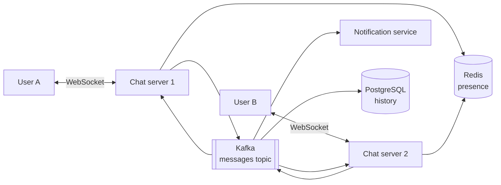

# Realtime Chat

Inspired by WhatsApp.

**Deadline:** Saturday 19 December 2026
**Stack:** Spring Boot, WebSockets, Redis, Kafka
**Tracker:** [Tracker.md](Tracker.md)

## What it does

Users send messages to each other in real time, see who is online and get notified when they are away.

## Features

- [ ] Realtime one to one messaging over WebSockets
- [ ] Message history
- [ ] Presence: online, offline, last seen
- [ ] Notifications for offline users
- [ ] Group chat (stretch)
- [ ] Delivered and read receipts (stretch)

## Architecture

## Key decisions

| Decision | Choice | Why |
|---|---|---|
| Transport | WebSockets with STOMP | Built into Spring |
| Cross server delivery | Kafka | Learn it, and it decouples servers |
| Presence | Redis keys with TTL and heartbeat | Cheap, expires by itself |
| Ordering | Partition by conversation id | Order is kept within a conversation |

## Milestones

| Date | Milestone |
|---|---|
| Tue 15 Dec | Design on paper, WebSocket echo server |
| Wed 16 Dec | Two users messaging on one server |
| Thu 17 Dec | Kafka between two server instances, history in PostgreSQL |
| Fri 18 Dec | Presence and notifications (after the URL Shortener is shipped) |
| Sat 19 Dec | Polish, Docker Compose, README, demo |

> This is the tightest deadline on the plan. Start the design early, and cut group chat and receipts first.

## Definition of done

- [ ] Two browser tabs can chat in real time
- [ ] Two server instances still deliver messages between users
- [ ] Presence works
- [ ] Runs with one `docker compose up`
- [ ] README with diagram and decisions
