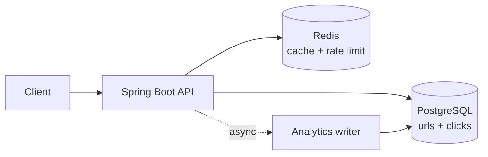

# URL Shortener

Inspired by Bitly.

**Deadline:** Friday 18 December 2026
**Stack:** Spring Boot, PostgreSQL, Redis
**Tracker:** [Tracker.md](Tracker.md)

## What it does

Paste a long URL, get a short one. Visiting the short one redirects to the original and records the click.

## Features

- [ ] Create a short URL
- [ ] Redirect with `302`
- [ ] Custom aliases
- [ ] Expiry dates
- [ ] Click analytics: count, referrer, country, device, per day
- [ ] Redis caching for redirects
- [ ] Rate limiting per IP

## Design targets

| Number | Value |
|---|---|
| New URLs | 100 per second |
| Redirects | 10,000 per second (100:1 read to write) |
| Cache hit rate | 90% or more |
| Redirect latency (cached) | under 20 ms |

## API sketch

| Method | Path | Purpose |
|---|---|---|
| `POST` | `/api/urls` | Create a short URL |
| `GET` | `/{code}` | Redirect |
| `GET` | `/api/urls/{code}/stats` | Analytics |
| `DELETE` | `/api/urls/{code}` | Delete |

## Architecture

## Key decisions

| Decision | Choice | Why |
|---|---|---|
| Code generation | Base62 of a counter | Short, no collisions |
| Redirect status | 302 | So clicks are always counted |
| Rate limiting | Redis `INCR` with expiry | Simple and fast |

## Milestones

| Date | Milestone |
|---|---|
| Mon 14 Dec | Design written in [System-Design](../../System-Design) |
| Tue 15 Dec | Create and redirect working with PostgreSQL |
| Wed 16 Dec | Redis cache and rate limiting |
| Thu 17 Dec | Analytics, Docker Compose, tests |
| Fri 18 Dec | Deployed, README finished, demo recorded |

## Definition of done

- [ ] Runs with one `docker compose up`
- [ ] Tests pass
- [ ] Deployed and reachable
- [ ] Load test numbers recorded in the README
- [ ] Diagram and design decisions written up
