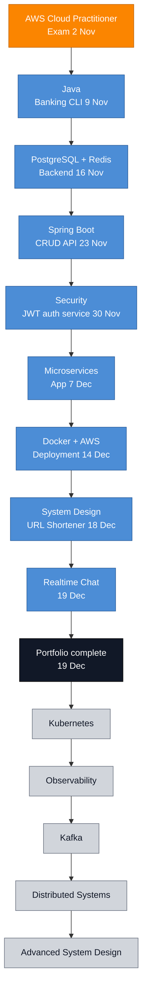

# Roadmap

## Deadlines

| Due | Deliverable |
|---|---|
| Mon 2 Nov | AWS Cloud Practitioner exam |
| Mon 9 Nov | Java Banking CLI |
| Mon 16 Nov | PostgreSQL + Redis backend |
| Mon 23 Nov | Spring CRUD API |
| Mon 30 Nov | JWT authentication service |
| Mon 7 Dec | Microservices application |
| Mon 14 Dec | Docker + AWS deployment |
| Fri 18 Dec | URL Shortener |
| Sat 19 Dec | Realtime Chat |
| Sat 19 Dec | Portfolio complete |

## Files

- [Dashboard.md](Dashboard.md) for progress
- [Roadmap.md](Roadmap.md) for the full diagram and week by week plan
- [Weekly-Reviews](Weekly-Reviews) for the weekly reviews
EOF
