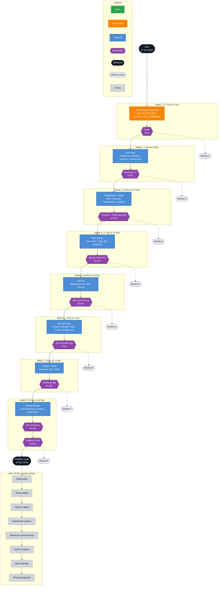

# Roadmap

```text
70% Coding  |  20% Documentation  |  10% Videos
Build first. Read docs second. Watch videos last.
```

## The path



**How to update it:** when a block is finished, change its `:::planned` or `:::current` to `:::done`, and give the next block `:::current`.

## Week by week

| Week | Dates (Tue to Mon) | Focus | Deliverable | LeetCode |
|---|---|---|---|---|
| 1 | 27 Oct to 2 Nov | AWS Cloud Practitioner | Exam, Mon 2 Nov | 0 |
| 2 | 3 Nov to 9 Nov | Core Java | Banking CLI, Mon 9 Nov | 8 |
| 3 | 10 Nov to 16 Nov | PostgreSQL and Redis | Backend, Mon 16 Nov | 8 |
| 4 | 17 Nov to 23 Nov | Spring Boot, JPA, REST | CRUD API, Mon 23 Nov | 8 |
| 5 | 24 Nov to 30 Nov | Spring Security, JWT, OAuth2 | Auth service, Mon 30 Nov | 8 |
| 6 | 1 Dec to 7 Dec | Microservices | Ecommerce services, Mon 7 Dec | 8 |
| 7 | 8 Dec to 14 Dec | Docker, AWS, system design | Deployed app, Mon 14 Dec | 5 |
| 8 | 15 Dec to 19 Dec | Projects and portfolio | URL Shortener Fri 18 Dec, Chat Sat 19 Dec | 5 |

Total LeetCode: 50.

> Weeks run Tuesday to Monday so each Monday deliverable closes its own week. 19 December is a Saturday, so the Chat app and the portfolio land on a weekend. Plan to have the Chat app mostly working by Thursday 17 Dec.

## Deliverables checklist

- [ ] **Mon 2 Nov: AWS Cloud Practitioner**
  - [ ] Two practice exams at 80% or more
  - [ ] Exam passed
  - [ ] Notes in [Certifications/AWS](Certifications/AWS/README.md)
- [ ] **Mon 9 Nov: Java Banking CLI**
  - [ ] Accounts, deposits, withdrawals, transfers
  - [ ] Custom exceptions for overdrafts and bad input
  - [ ] Transaction history using streams
  - [ ] Thread-safe balance updates
  - [ ] Unit tests and a README
- [ ] **Mon 16 Nov: PostgreSQL + Redis backend**
  - [ ] Schema with at least 4 tables and proper indexes
  - [ ] Cache-aside reads through Redis
  - [ ] One query made at least 10x faster, with EXPLAIN output as proof
- [ ] **Mon 23 Nov: Spring CRUD API**
  - [ ] Full CRUD with validation and error handling
  - [ ] Spring Data JPA with at least one one-to-many relationship
  - [ ] Integration tests
- [ ] **Mon 30 Nov: JWT authentication service**
  - [ ] Register, login, refresh, logout
  - [ ] Role based access
  - [ ] OAuth2 login with one provider
- [ ] **Mon 7 Dec: Microservices application**
  - [ ] At least 3 services plus gateway and discovery
  - [ ] Central config
  - [ ] Circuit breaker on one remote call
- [ ] **Mon 14 Dec: Docker + AWS deployment**
  - [ ] Dockerfile per service
  - [ ] Docker Compose runs everything locally with one command
  - [ ] Live on AWS with RDS
- [ ] **Fri 18 Dec: URL Shortener**
- [ ] **Sat 19 Dec: Realtime Chat**
- [ ] **Sat 19 Dec: Portfolio complete**
  - [ ] Three project READMEs with diagrams
  - [ ] Profile README and pinned repos

## System design runs all the way through

System design is not a final week topic. It gets about 30 minutes of the docs block every day.

| Weeks | Topics |
|---|---|
| 1 to 2 | Client server basics, HTTP, latency numbers |
| 3 | Caching, cache invalidation, eviction |
| 4 to 5 | REST design, authentication at scale |
| 6 | Service boundaries, API gateway, async messaging |
| 7 | Load balancing, horizontal scaling, replication |
| 8 | Kafka, CAP theorem, consistency models, design the URL Shortener and Chat on paper first |

## Weekly accountability

Every Monday, 30 minutes:

1. Fill in that week's file in [Weekly-Reviews](Weekly-Reviews).
2. Update the numbers in [Dashboard.md](Dashboard.md).
3. Update the Mermaid diagram colours.
4. Write next week's plan with specific tasks.
5. If a deliverable is behind, decide what to cut.

## Career progression

Rough direction after the eight weeks. These are not promises, just the order I want to learn things in.

| When | Focus | Output |
|---|---|---|
| Jan to Feb 2027 | Kubernetes | Deploy the Ecommerce services to a local cluster |
| Mar 2027 | Observability | Metrics, logs and traces for the Ecommerce app |
| Apr 2027 | Kafka in depth | Rebuild Chat messaging on proper partitions and consumer groups |
| May to Jun 2027 | Distributed systems | Consensus, replication, failure modes, write about each |
| H2 2027 | Advanced system design | Weekly design write ups, mock interviews |
| Beyond | Senior, then Staff, then Principal | Scope grows from a feature, to a system, to many teams |

What changes at each level:

- **Senior Engineer:** owns a service end to end and ships without hand holding.
- **Staff Engineer:** sets technical direction across teams and makes others faster.
- **Principal Engineer:** shapes the long term architecture of a whole organisation.
